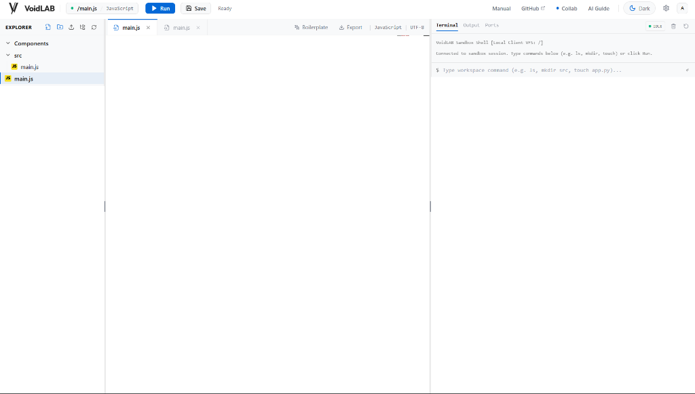
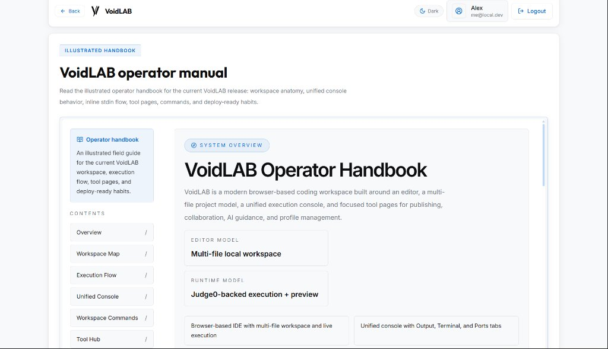
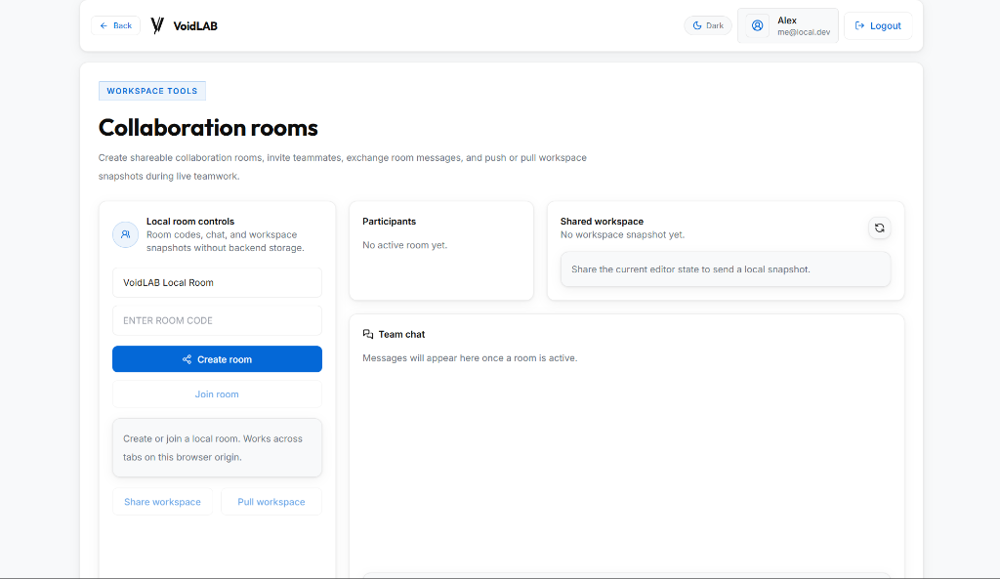
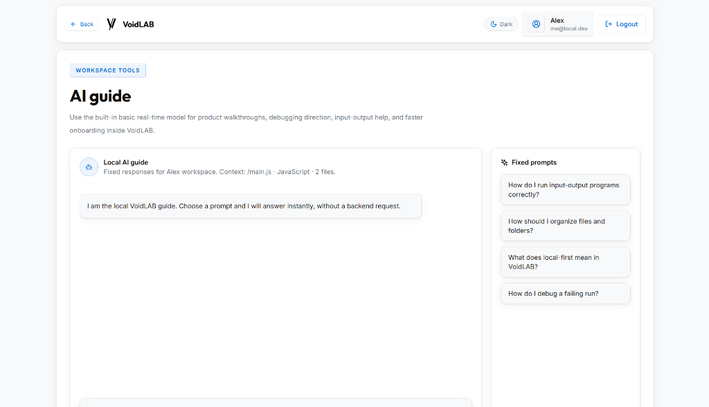
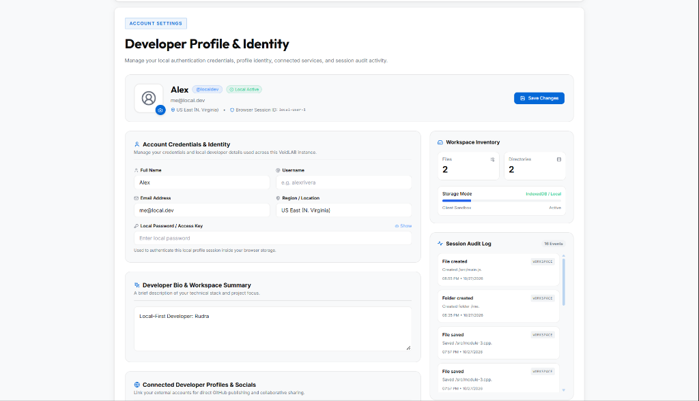

<p align="center">
  <a href="https://voidlab-5f16.onrender.com">
    
  </a>
</p>

<p align="center">
  <strong>Local-First Browser IDE, Ephemeral Execution Engine & Developer Workspace</strong>
</p>

---

## Architectural Overview

VoidLAB is a browser-based software development workspace built around a **100% stateless backend architecture**. The platform eliminates external database dependencies by storing all file trees, editor buffers, user preferences, and session tokens locally within browser storage (`localStorage` and `IndexedDB`), while delegating code execution to an isolated host runtime.

### Technical Foundation

- **Backend Runtime**: Pure Go standard library HTTP multiplexer (`net/http`, Go 1.22+ routing) with zero external ORM or database drivers.
- **Frontend Layer**: Server-driven UI templates rendered via `html/template`, styled with utility CSS, and driven by `HTMX` for targeted fragment swaps without single-page application framework bloat.
- **Client Persistence**: Local-first Virtual File System (VFS) retaining full directory structures and workspace state on-device.
- **Terminal & Execution**: Bi-directional WebSocket pipeline (`/api/ws/terminal`) streaming process `stdin`, `stdout`, and `stderr` directly between an `xterm.js` terminal emulator and sandboxed OS execution binaries.
- **Security & Sandboxing**: Strict process isolation using `context.WithTimeout`, resource limits, path traversal verification, and HMAC-SHA256 signed stateless JWT session authentication.

---

## System Architecture

```
===================================================================================
                               VOIDLAB SYSTEM ARCHITECTURE
===================================================================================

 [ Browser Client ]
  +-------------------------------------------------------------------------------+
  |  UI Layer (HTML5 / HTMX / TailwindCSS)                                        |
  |  - Editor Canvas: Multi-tab buffer manager, syntax highlighter                |
  |  - Tool Views: Manual, Collaboration, AI Guide, Developer Profile             |
  |  - Unified Console: xterm.js live stream, output metrics, forwarded ports    |
  |                                                                               |
  |  Client Storage Engine (100% Stateless Server)                                |
  |  +-------------------------------------+  +--------------------------------+  |
  |  | localStorage: Profile, Theme, Cache |  | IndexedDB: Multi-file VFS      |  |
  |  +-------------------------------------+  +--------------------------------+  |
  +-------------------------------------------------------------------------------+
                                  |                     |
                   HTTP / REST    |                     | WebSocket Streaming
                  (Go Handlers)   |                     | (/api/ws/terminal)
                                  v                     v
 [ Go Application Server ]
  +-------------------------------------------------------------------------------+
  |  cmd/voidlab/main.go (Port 8080)                                              |
  |  +-------------------+  +-------------------+  +----------------------------+ |
  |  | src/auth          |  | src/explorer      |  | src/collab                 | |
  |  | - JWT HMAC-SHA256 |  | - Safe VFS Sync   |  | - In-Memory Ephemeral Room | |
  |  | - Cookie Sessions |  | - Path Traversal  |  | - Broadcast Bus            | |
  |  +-------------------+  +-------------------+  +----------------------------+ |
  |  +-------------------+  +-------------------+  +----------------------------+ |
  |  | src/ai            |  | src/wasmcore      |  | src/terminal               | |
  |  | - Guidance Engine |  | - Syntax Analysis |  | - Upgrader & Pumping       | |
  |  | - SSE Streaming   |  | - Code Formatting |  | - Process Stdin Pipe       | |
  |  +-------------------+  +-------------------+  +----------------------------+ |
  +-------------------------------------------------------------------------------+
                                  |
                        Subprocess Fork & Exec
                     (os/exec + context.WithTimeout)
                                  v
 [ Ephemeral Execution Engine (God Image Architecture) ]
  +-------------------------------------------------------------------------------+
  |  Isolated Temporary Directory (/tmp/voidlab-run-XXXXXX)                       |
  |  +--------------------+  +--------------------+  +--------------------------+ |
  |  | GCC / G++ (C, C++) |  | Python 3 / Node.js |  | Go Compiler / Rust Cargo | |
  |  +--------------------+  +--------------------+  +--------------------------+ |
  |  | OpenJDK 17 (Java)  |  | PHP / Ruby / Perl  |  | Bash / Shell Scripting   | |
  |  +--------------------+  +--------------------+  +--------------------------+ |
  |                                                                               |
  |  Enforced Constraints:                                                        |
  |  - Wall-clock timeout: 5.0 seconds (prevents runaway computation)             |
  |  - Immediate directory clean-up on process termination                        |
  +-------------------------------------------------------------------------------+
===================================================================================
```

---

## Execution & Stdin Streaming Pipeline

The execution engine streams input and output bi-directionally without intermediate file polling:

```
+-------------+                 +------------------+                 +-------------------+
|  xterm.js   | -- Keystroke -> |  src/terminal/   | -- stdin pipe ->| Subprocess Target |
|   Terminal  | <- stdout/err - |     ws.go        | <- stdout/err - | (python, gcc, go) |
+-------------+  (WebSocket)    +------------------+   (OS IO Pipe)  +-------------------+
       |                                                                       |
       |                                                                       |
       +------------ Process Completion (Exit Code, Duration) ---------------+
```

1. **Trigger**: User initiates execution via `Ctrl+Enter` or Topbar `Run`.
2. **Directory Isolation**: Source files from active editor buffers are written to an isolated temporary directory.
3. **Process Fork**: Host binary is invoked with an execution timeout context (`context.WithTimeout`).
4. **Bi-directional Pipe**: Standard input from the client is written directly to the child process's `stdin` pipe; standard output and diagnostic errors are streamed chunk-by-chunk to the client terminal over WebSockets.
5. **Teardown**: On termination, exit codes and runtime metrics are finalized, and temporary build artifacts are purged immediately.

---

## Authentication & Stateless Session Lifecycle

```
[ Client Browser ]                                        [ VoidLAB Server ]
        |                                                          |
        | 1. POST /api/auth/login (username)                       |
        |--------------------------------------------------------->|
        |                                                          | Signs HMAC-SHA256 JWT
        |                                                          | with SESSION_SECRET
        | 2. Set-Cookie: voidlab_session=<JWT>; HttpOnly; Secure   |
        |<---------------------------------------------------------|
        |                                                          |
        | 3. Authenticated Navigation (/editor, /editor/*)         |
        |--------------------------------------------------------->|
        |                                                          | Validates JWT Signature
        | 4. Render Requested View (Full Page HTML)                |
        |<---------------------------------------------------------|
```

- **Stateless Validation**: The server verifies token integrity on every request without contacting an external authentication authority or database.
- **Client Cache**: Non-sensitive UI data (active theme, display aliases, and local preferences) are cached in browser `localStorage`.

---

## Interface & Workspace Surfaces

VoidLAB provides focused full-page views engineered for specific development tasks:

<table>
  <tr>
    <td width="50%" valign="top">
      
      <br />
      <strong>1. Main Editor & Unified Console</strong>
      <br />
      Locked viewport layout with file tree, multi-tab buffer manager, boilerplate generator, WebAssembly syntax validator, and an interactive terminal.
    </td>
    <td width="50%" valign="top">
      
      <br />
      <strong>2. Operator Manual</strong>
      <br />
      Illustrated technical handbook detailing workspace architecture blueprints, runtime models, execution flows, and console commands.
    </td>
  </tr>
  <tr>
    <td width="50%" valign="top">
      
      <br />
      <strong>3. Collaboration Rooms</strong>
      <br />
      In-memory multiplayer rooms featuring peer-to-peer workspace snapshot transfers and live room chat with zero backend persistence.
    </td>
    <td width="50%" valign="top">
      
      <br />
      <strong>4. Local AI Guide</strong>
      <br />
      Embedded guidance console offering contextual product walk-throughs, input-output streaming guidance, and runtime diagnostic tips.
    </td>
  </tr>
  <tr>
    <td colspan="2" align="center" valign="top">
      
      <br />
      <strong>5. Developer Profile & Identity</strong>
      <br />
      Stateless identity dashboard displaying credentials, local inventory counters (files/folders), storage mode meters, and session audit logs.
    </td>
  </tr>
</table>

---

## Supported Runtime Environments

The execution orchestrator detects and compiles the following environments out of the box:

| Language | Runtime / Compiler | Execution Mode | Target Extensions |
| :--- | :--- | :--- | :--- |
| **Python** | `python3` (3.10+) | Direct execution | `.py` |
| **JavaScript** | `node` (Node.js LTS) | V8 engine execution | `.js`, `.mjs` |
| **TypeScript** | `ts-node` / `esbuild` | Transpiled execution | `.ts` |
| **C** | `gcc` (C17/C23) | Compiled binary execution | `.c` |
| **C++** | `g++` (C++20 standard) | Compiled binary execution | `.cpp`, `.cc`, `.cxx` |
| **Go** | `go run` (Go 1.22+) | Native compilation | `.go` |
| **Rust** | `rustc` | Compiled binary execution | `.rs` |
| **Java** | `javac` + `java` (OpenJDK 17) | Bytecode execution | `.java` |
| **PHP** | `php-cli` | CLI script execution | `.php` |
| **Ruby** | `ruby` | Interpreted execution | `.rb` |
| **Perl** | `perl` | Interpreted execution | `.pl` |
| **Bash** | `bash` | Shell execution | `.sh` |
| **SQL** | `sqlite3` | In-memory relational queries | `.sql` |
| **Web Preview** | Direct HTTP Canvas | In-browser preview canvas | `.html`, `.css` |

---

## Project Structure

```
VoidLAB/
|-- cmd/
|   `-- voidlab/
|       |-- main.go                 # Application entrypoint & HTTP router wiring
|       |-- main_test.go            # Route and integration tests
|       `-- routes_test.go          # HTMX endpoint audit tests
|-- src/
|   |-- ai/                         # AI guide handlers & streaming response engine
|   |-- auth/                       # JWT token signing, middleware & authentication
|   |-- collab/                     # Ephemeral in-memory collaboration rooms
|   |-- docker/                     # Subprocess execution orchestrator & security limits
|   |-- explorer/                   # Virtual File System (VFS) & workspace file management
|   |-- terminal/                   # WebSocket terminal upgrader & xterm.js streaming
|   `-- wasmcore/                   # WebAssembly core module for client-side validation
|-- web/
|   `-- templates/                  # Server-rendered HTML templates
|       |-- base.tmpl               # Root HTML structure, themes & scripts
|       |-- topbar.tmpl             # Top navigation bar
|       |-- tool_header.tmpl        # Shared tool header (Back, Theme, User, Logout)
|       |-- editor.tmpl             # Main editor canvas & buffer tabs
|       |-- explorer.tmpl           # File tree explorer & modals
|       |-- terminal.tmpl           # Terminal emulator & output metric panels
|       |-- ai.tmpl                 # AI guide full page & fragments
|       |-- collab.tmpl             # Collaboration full page & room controls
|       |-- profile.tmpl            # Developer profile & session audit full page
|       |-- manual.tmpl             # Operator handbook full page
|       |-- github.tmpl             # GitHub sync & CLI reference full page
|       `-- index.tmpl              # Public landing & login page
|-- public/
|   |-- assets/                     # Brand vectors and icons
|   |-- showcase/                   # Product preview images
|   `-- wasm/                       # Pre-compiled WebAssembly binaries
|-- Dockerfile                      # God-image multi-language production container
|-- Makefile                        # Build, test, and run automation targets
`-- go.mod                          # Go module definitions
```

---

## Local Development & Build

### Prerequisites

- **Go**: Version 1.22 or higher
- **Compilers / Interpreters**: `python3`, `gcc`, `g++`, `node` installed on system path

### Running Locally

```bash
# Clone repository
git clone https://github.com/Voxion-Labs/VoidLAB.git
cd VoidLAB

# Run test suite across all packages
go test -v ./...

# Build binary
go build -o bin/voidlab ./cmd/voidlab

# Launch server
./bin/voidlab
```

The workspace will be available at `http://127.0.0.1:8080/`.

---

## Container Deployment

The project includes a multi-stage `Dockerfile` creating a self-contained God-Image equipped with all language compilers:

```bash
# Build container image
docker build -t voidlab .

# Run container
docker run -p 8080:8080 --rm voidlab
```

---

## License

VoidLAB is protected under a custom restricted license.

The full license text is available in [LICENSE](LICENSE).

License summary:

- copyright © 2026 Rudranarayan Jena
- all rights reserved
- no copying, modification, distribution, hosting, reuse, or derivative work without prior written permission
- no commercial or non-commercial use is allowed unless explicitly approved by the author

VoidLAB is not released as an open-source project under MIT, Apache, GPL, or any other permissive/public license.

---

<br>
<div align="right">
  <b>Rudranarayan Jena</b><br>
  <i>Founder @ Voxion Labs</i>
</div>

---
<div align="center">
  (c) 2026 Voxion Labs & Rudranarayan Jena
</div>
